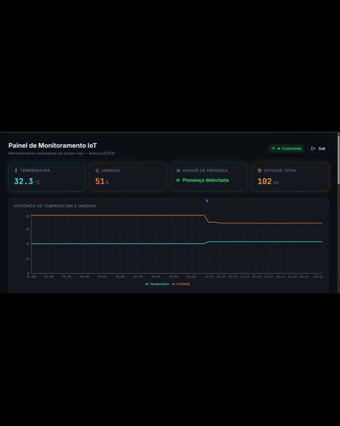

# Arduino32 Sensor Telemetry

ESP32 Arduino firmware and a C11 serial receiver based on the temperature, humidity and presence monitoring shown in `arduino32sensor (1)(1).mp4`.

## Capabilities

- Real DHT acquisition and debounced PIR presence input.
- Fixed 20-byte binary frames with CRC-16/CCITT-FALSE integrity checks.
- Stream resynchronization after corrupt bytes.
- Sequence gap, duplicate and restart detection.
- Online temperature mean and variance.
- Temperature alarm with hysteresis.
- CSV output and a future repository callback.

## Native receiver

Linux, a C11 compiler and GNU Make.

```sh
make all test
./build/telemetry /dev/ttyUSB0 > readings.csv
```

CSV fields: sequence, uptime in milliseconds, temperature in hundredths of a degree Celsius, humidity in hundredths of one percent, presence and sensor validity. Statistics are written to stderr when the receiver stops. Only one program may own the device serial port.

## Firmware

Sketch: `firmware/sensor_node/sensor_node.ino`.

Install Arduino CLI, the Espressif ESP32 core and Adafruit DHT sensor libraries:

```sh
arduino-cli core update-index --additional-urls https://espressif.github.io/arduino-esp32/package_esp32_index.json
arduino-cli core install esp32:esp32 --additional-urls https://espressif.github.io/arduino-esp32/package_esp32_index.json
arduino-cli lib install "DHT sensor library" "Adafruit Unified Sensor"
make firmware
arduino-cli upload --fqbn esp32:esp32:esp32 --port /dev/ttyUSB0 firmware/sensor_node
```

Board and sensor selection are configurable; the repository defaults are ESP32 Dev Module and DHT11. Confirm the actual board, sensor model and wiring before upload. Wiring: [docs/hardware.md](docs/hardware.md). Protocol: [docs/protocol.md](docs/protocol.md). Official setup references: [Arduino CLI](https://arduino.github.io/arduino-cli/latest/) and [Espressif Arduino installation](https://docs.espressif.com/projects/arduino-esp32/en/latest/installing.html).

No database is connected. To persist samples, implement `sample_repository.write`; a failed write does not advance monitoring state. Adapter requirements: [docs/persistence.md](docs/persistence.md).

## Validation

Native unit tests cover every single-bit frame corruption, negative temperature, parser recovery, duplicates, dropped frames, restart handling, variance, alarm hysteresis and repository failures. Serial integration was exercised with a pseudo-terminal. Board compilation and physical acquisition are separate checks; see [docs/validation.md](docs/validation.md).

## Video evidence

[](evidence/demo.mp4)

[Open the original demonstration](evidence/demo.mp4)

The video demonstrates the author's reference setup, including a database-backed dashboard. This implementation deliberately uses serial transport and CSV instead. It is new source based on the observed hardware domain; the recording is not a test run of this code. Original filename and SHA-256: [evidence/provenance.json](evidence/provenance.json).

## Credits and license

Created for [brunnodev.store](https://brunnodev.store/). MIT: [LICENSE](LICENSE).
